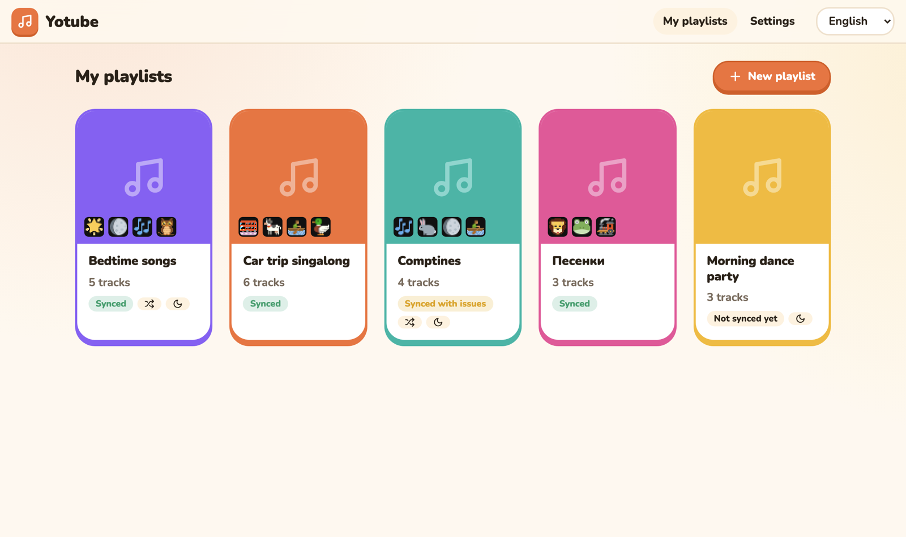
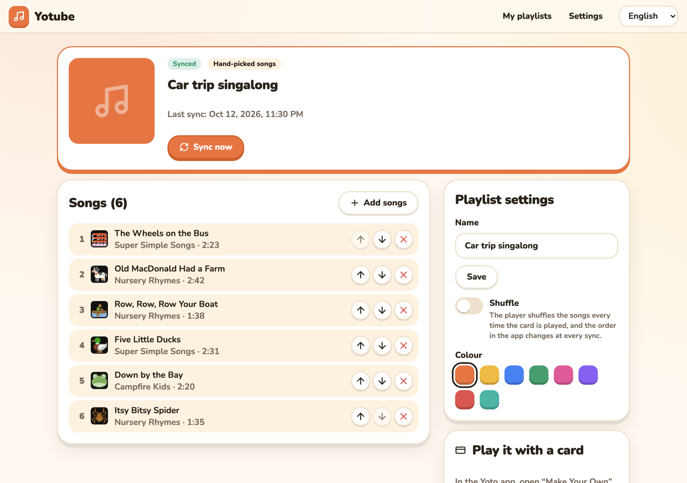
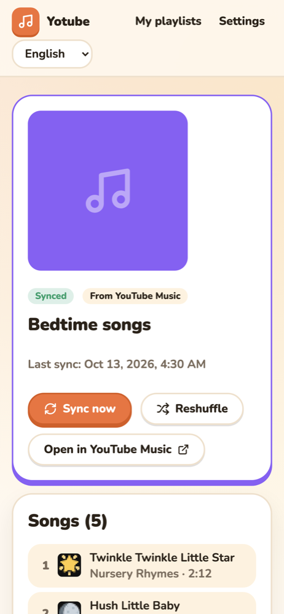

# Yotube

Turn YouTube Music playlists into [Yoto](https://yotoplay.com) playlists — and keep them in sync.

<p align="center">
  <picture>
    <source media="(prefers-color-scheme: dark)" srcset="docs/screenshots/library-dark.png">
    
  </picture>
</p>

Yotube is a small self-hosted web app (one Docker container) for parents with a Yoto player:

- **Import** a YouTube Music playlist from its link, or **pick songs** one by one with search.
- The playlist lands in your **Yoto library**: play it from the Yoto app, or link it to a blank
  **Make Your Own card**.
- Imported playlists stay **mirrored**: songs added, removed or reordered on YouTube Music follow,
  on demand or every night.
- **Shuffle** mode: the player shuffles songs at every play, and the app order changes at every sync.
- Every song gets a **16×16 pixel icon** on the player screen, picked from Yoto's icon library
  (smarter with an optional Claude API key). You can change any icon by hand.
- **Listen before adding**: play any search result or imported song right in the browser.
- Interface in **English, French and Russian**, light or dark, and usable on a phone.

<p align="center">
  
  
</p>

> Yotube is a personal project, not affiliated with Yoto or YouTube.

## How it works

```
YouTube Music ──search / playlist──▶ Yotube ──audio upload──▶ Yoto API ──▶ Yoto library
                 (ytmusicapi, yt-dlp)   │                       (transcoding)    ├─ Yoto app
                                        └─ SQLite in /data                       └─ MYO card
```

Yotube downloads the audio of each new song once, uploads it to Yoto (Yoto converts it for its
players), then rewrites the Yoto playlist. Songs already uploaded are never downloaded again.

## Quick start

### 1. Create a Yoto developer app (once)

1. Go to <https://dashboard.yoto.dev> and sign in with your Yoto account.
2. Create an application (public client, no client secret).
3. Add the allowed callback URL: `http://localhost:8080/auth/callback`.
4. Enable the scopes `user:content:manage` and `offline_access`.
5. Copy the **Client ID**.

### 2. Configure

```bash
git clone https://github.com/kinsoi/yotube.git
cd yotube
cp .env.example .env
```

Edit `.env` and set `YOTO_CLIENT_ID`. Optionally set `ANTHROPIC_API_KEY` for smarter icons.
Keep the `PORT` line in `.env`: Docker Compose reads it both for the port mapping and for the
container.

If port 8080 is already taken, set `PORT=8090` and `PUBLIC_URL=http://localhost:8090` in `.env`,
and register `http://localhost:8090/auth/callback` at Yoto instead.

### 3. Run

```bash
docker compose up -d
```

This uses the published image `ghcr.io/kinsoi/yotube` (about 380 MB, of which Deno, which yt-dlp
needs to download from YouTube, is about 100 MB). To build it yourself instead:
`docker compose up -d --build`.

### 4. Connect and create

1. Open <http://localhost:8080> **on the machine running Docker** and go to **Settings → Connect to Yoto**.
   (The Yoto login redirects to `localhost`; after that, you can use Yotube from any device on your network.)
2. Click **New playlist**, paste a YouTube Music playlist link (public or unlisted), and create it.
3. Watch the progress; after a few minutes the playlist is in the Yoto app.
4. To use a card: in the Yoto app, open *Make Your Own*, pick the playlist and link it to a blank card.
   The card follows the playlist forever, even after syncs.

## Configuration

| Variable | Default | Description |
|---|---|---|
| `YOTO_CLIENT_ID` | — | **Required.** Client ID from dashboard.yoto.dev |
| `PUBLIC_URL` | `http://localhost:8080` | URL used to open Yotube; the callback `PUBLIC_URL/auth/callback` must be registered at Yoto |
| `ANTHROPIC_API_KEY` | empty | Enables icon picking by Claude (a few cents per month) |
| `ANTHROPIC_MODEL` | `claude-haiku-5-5` | Model used for icon picking |
| `SYNC_CRON` | `0 3 * * *` | Nightly sync schedule (cron) |
| `TZ` | `Europe/Paris` | Timezone of the schedule |
| `PORT` | `8080` | HTTP port (must be present in `.env`) |
| `YTDLP_AUTO_UPDATE` | `true` | Update yt-dlp at container start |
| `LOG_LEVEL` | `INFO` | Log verbosity |
| `ALLOWED_HOSTS` | empty | Extra host names allowed to reach Yotube (comma-separated, see below) |

Data (database and Yoto session) lives in the named Docker volume `yotube-data`. If you bind-mount
a host folder over `/data` instead, make sure it is writable by uid 1000 (the container user).

Yotube answers only to `localhost`, IP addresses, the host of `PUBLIC_URL` and local names ending in
`.local`, `.lan`, `.home` or `.internal`. If you open it under another name (for example
`http://nas:8080`), add that name to `ALLOWED_HOSTS`.

## Updating

```bash
docker compose pull && docker compose up -d
```

## Troubleshooting

- **"Sync failed" with download errors** — YouTube changed something. Restart the container
  (`docker compose restart`) so yt-dlp updates itself, then sync again.
- **"Could not read playlist"** — the playlist must be public or unlisted. Private playlists and
  "Liked music" cannot be read.
- **Yotube asks to reconnect** — the Yoto session expired or was revoked. Reconnect from Settings,
  from the machine running Docker.
- **A song shows "Unavailable on YouTube"** — the video was removed or blocked. If it was already on
  your Yoto, Yotube keeps it there.
- **Port 8080 already in use** — see the `PORT` note in [Configure](#2-configure).
- Logs: `docker compose logs -f yotube`.

## Security and fair use

- Yotube has **no login of its own**. Keep it on your home network; never expose it to the internet.
  It refuses unknown host names and cross-site requests, so a web page you visit cannot drive it.
- Your Yoto session and the database stay in the `yotube-data` volume; nothing is sent anywhere else
  except YouTube (to fetch songs), Yoto (to upload them) and, if configured, Anthropic (song titles only,
  to pick icons).
- Downloading audio from YouTube may conflict with YouTube's Terms of Service. Use Yotube for
  personal, family use only, with content you are allowed to listen to.

## Development

```bash
# Backend (Python 3.12+). Deno must be on PATH for yt-dlp to download from YouTube:
#   brew install deno
cd backend && python3 -m venv .venv && .venv/bin/pip install -e '.[dev]'
DATA_DIR=../data .venv/bin/uvicorn app.main:create_app --factory --reload --port 8080
.venv/bin/pytest && .venv/bin/ruff check . && .venv/bin/mypy app

# Frontend (Node 22) — dev server proxies /api to :8080
cd frontend && npm install && npm run dev
npm test && npm run check && npm run lint
```

Releases: push a tag `vX.Y.Z`; CI publishes a multi-arch image to `ghcr.io/kinsoi/yotube`.

## En français

Yotube transforme des playlists YouTube Music en playlists Yoto, et les garde synchronisées.

1. Crée une application sur <https://dashboard.yoto.dev> (client public), ajoute l'URL de retour
   `http://localhost:8080/auth/callback`, active les scopes `user:content:manage` et `offline_access`,
   puis copie le *Client ID*.
2. `cp .env.example .env`, puis renseigne `YOTO_CLIENT_ID` (et éventuellement `ANTHROPIC_API_KEY`
   pour des icônes plus pertinentes).
3. `docker compose up -d`, puis ouvre <http://localhost:8080> **sur la machine qui fait tourner Docker** :
   *Réglages → Se connecter à Yoto*.
4. *Nouvelle playlist* : colle un lien de playlist YouTube Music (publique ou non répertoriée) ou
   choisis des chansons. La playlist apparaît dans l'app Yoto ; pour une carte, associe-la à une
   carte MYO vierge dans l'app Yoto.

On peut écouter chaque chanson avant de l'ajouter, et choisir un thème clair ou sombre.
L'interface est disponible en français, anglais et russe. Usage strictement personnel et familial ;
ne l'expose pas sur Internet.

## License

[MIT](LICENSE)
